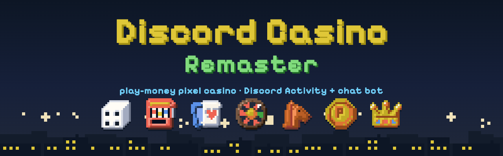
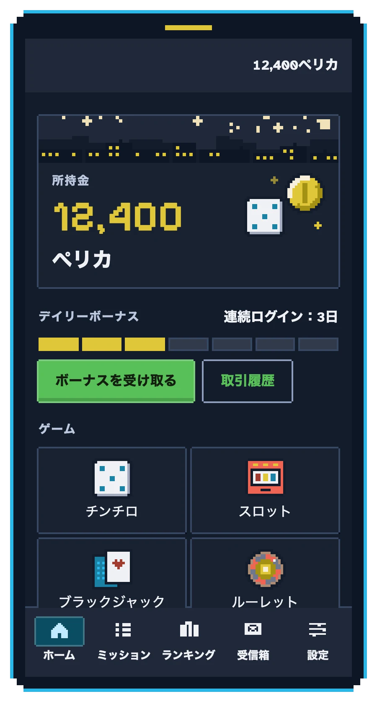
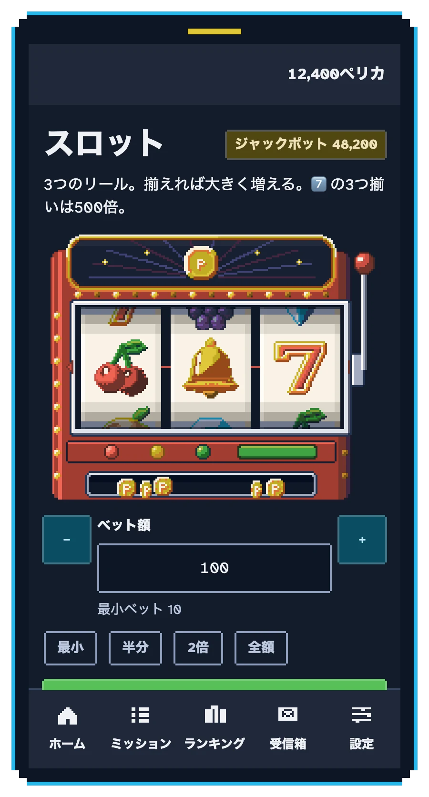
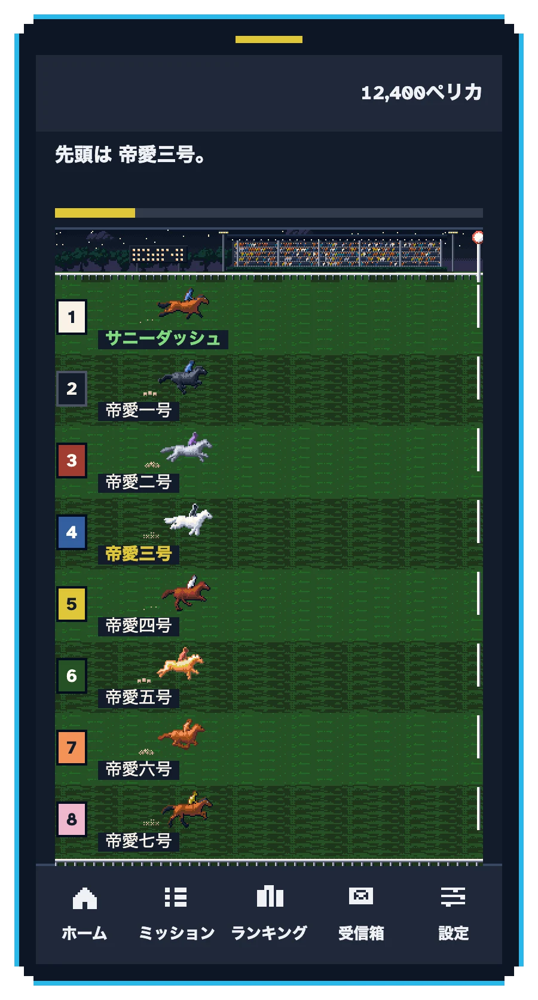
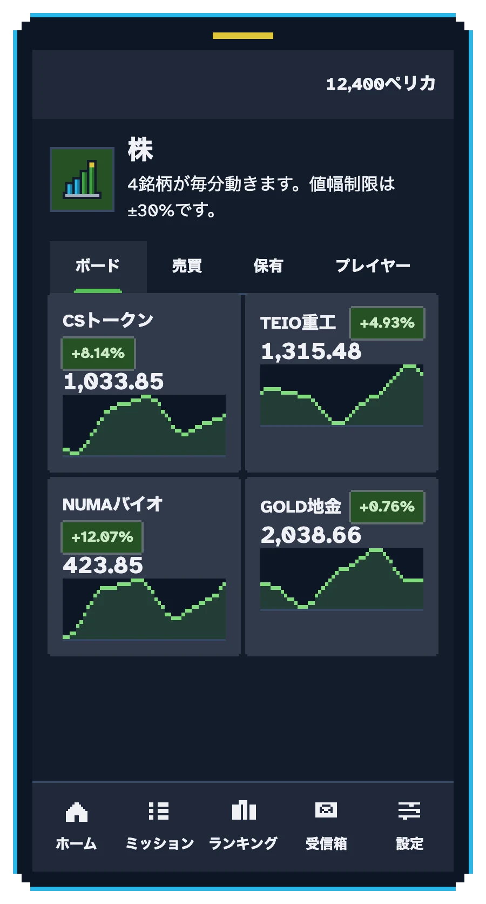
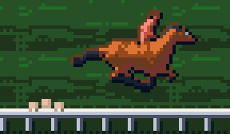
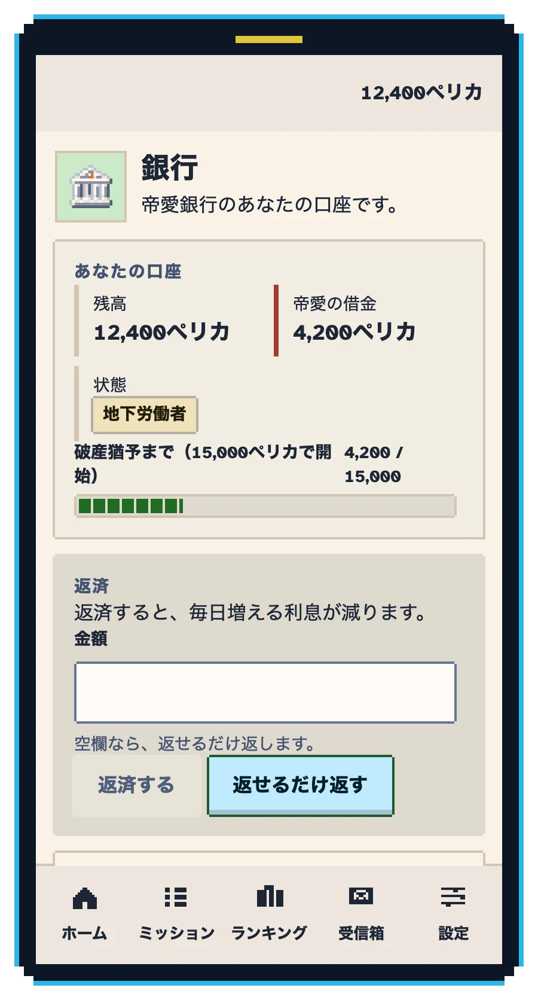

[English](README.md) | **日本語**

<p align="center">
  
</p>

<p align="center">
  <b>Discord サーバーで遊べる、ピクセルアートのお遊びカジノ。ゲームに競馬に株に、ちょっと怖い銀行まで。</b>
</p>

<p align="center">
  <a href="https://github.com/S3nc0/discord-casino-bot-remaster/actions/workflows/ci.yml"></a>
  <a href="LICENSE"></a>
  <a href="docs/OWNER_SETUP.ja.md"></a>
  <a href="docs/OWNER_SETUP.ja.md"></a>
  
</p>

> [!NOTE]
> **ペリカはゲームの中だけのお金です。** 現実のお金とは関係なく、換金も購入もできません。残高はサーバーごとに別々で、はじめは 3,000 ペリカからスタートします。

## のぞいてみよう

下の画面は、すべて Discord の中で動く**アクティビティ**（スマホでもパソコンでも使えるミニアプリ）です。ダークとライトのどちらでも、同じドット絵の見た目で遊べます。画像はすべてテスト用のダミーデータです。

<table>
  <tr>
    <td align="center"></td>
    <td align="center"></td>
    <td align="center"></td>
    <td align="center"></td>
  </tr>
  <tr>
    <td align="center"><b>ホーム</b></td>
    <td align="center"><b>スロット</b></td>
    <td align="center"><b>競馬</b></td>
    <td align="center"><b>株</b></td>
  </tr>
</table>

<p align="center"><br><sub>レース画面で再生される、1歩分8コマの駆け足です。</sub></p>

<details>
<summary>ライトモードもあります（帝愛銀行の画面）</summary>

<p align="center"></p>

</details>

## できること

<table>
  <tr>
    <td width="33%"> <b>チンチロ</b><br>親と3つのサイコロで勝負。目が出なければ3回まで振れます。</td>
    <td width="33%"> <b>スロットとパチンコ</b><br>レバーを引いて、大当たりを狙おう。</td>
    <td width="33%"> <b>ブラックジャックとルーレット</b><br>ヒット、スタンド、ダブル。全額を赤に賭けるのもアリ。</td>
  </tr>
  <tr>
    <td> <b>競馬</b><br>自分の馬を走らせて、馬券も買える。次の名馬も育てられます。</td>
    <td> <b>地下闘技場</b><br>毎日開かれる、NPC 戦士の大会に賭けよう。</td>
    <td> <b>株と暗号資産</b><br>毎分動く4銘柄。信用取引とオプションは勇者向け。</td>
  </tr>
  <tr>
    <td> <b>帝愛銀行</b><br>借りて、返して、破産しないように気をつけて。</td>
    <td> <b>地下労働</b><br>ペリカが尽きたら、鉱石と発掘品を掘りに行こう。</td>
    <td> <b>抽選・クイズ・投票</b><br>誰でも始められる、サーバーみんなの遊び。</td>
  </tr>
  <tr>
    <td> <b>ランキング</b><br>週間王者や総資産の順位が見られます。</td>
    <td> <b>ショップと取引</b><br>称号や名前の色、アイテムを交換。ほかの人との取引もできます。</td>
    <td> <b>安心の作り</b><br>賭け金は先に預かって、1回の処理で精算します。ゲームの途中でペリカが消えることはありません。</td>
  </tr>
</table>

画面は**日本語と英語**に対応していて、Discord の言語設定に合わせて切り替わります。

## はじめかた

必要なものは、Node.js 24、pnpm 12.21.0、Discord アカウント、無料の Cloudflare アカウントです。初回は20〜30分ほどかかります。

1. **コードを用意する。** リポジトリを `git clone` して、`pnpm i` と `pnpm -r build` を実行します。
2. **Discord アプリを作る。** Developer Portal で作成し、アプリケーションID、公開キー、Bot トークンを控えます。
3. **Web アプリを置く。** Cloudflare Pages に公開します。
4. **`.env` を作る。** `.env.example` をコピーして記入し、Discord からサーバーに届くよう、トンネル（`cloudflared`）を起動します。
5. **全部起動する。** `pnpm dev:server`、続けて `pnpm commands:deploy:guild` を実行し、サーバーのロケットのアイコンからアクティビティを開きます。

```sh
git clone https://github.com/S3nc0/discord-casino-bot-remaster.git
cd discord-casino-bot-remaster
pnpm i && pnpm -r build
```

> [!IMPORTANT]
> Bot トークン、クライアントシークレット、`SESSION_SECRET` は、絶対に人に見せないでください。`.env` は git の管理対象外です。そのままにしておいてください。

画面を見ながら進められる、くわしい手順は **[持ち主向けセットアップガイド](docs/OWNER_SETUP.ja.md)**（[English](docs/OWNER_SETUP.md)）にあります。終わったあとの動作確認は、[動作確認ガイド](docs/OWNER_TESTING.ja.md)を見てください。

## チャットでも、アクティビティでも

どちらも残高とルールは同じなので、気分で使い分けられます。チャットのコマンドは手軽です。アクティビティは全画面で、卓や出馬表をリアルタイムで見られます。

コマンド名は Discord の言語設定に合わせて表示されます。日本語の Discord なら、日本語の名前で出てきます。

| やりたいこと | 日本語 | English |
| --- | --- | --- |
| デイリーボーナスを受け取る | `/ペリカ デイリー` | `/pelica daily` |
| 残高を見る | `/ペリカ 残高` | `/pelica balance` |
| チンチロを振る | `/カジノ チンチロ` | `/casino chinchiro` |
| スロットを回す | `/カジノ スロット` | `/casino slots` |
| ブラックジャックで遊ぶ | `/カジノ ブラックジャック` | `/casino blackjack` |
| 厩舎をのぞく | `/競馬 厩舎` | `/horse stable` |
| 闘技場の大会に賭ける | `/闘技場 大会` | `/arena tournament` |
| 株の市況を見る | `/証券 市況` | `/market board` |
| 帝愛銀行へ行く | `/ペリカ 帝愛` | `/pelica bank` |
| 地下で働く | `/地下 作業` | `/labor work` |
| ショップを開く | `/ショップ` | `/shop` |
| 使い方を聞く | `/help` | `/help` |

## 管理者向け

持ち主は `/運営`（英語では `/admin`）で、サーバーの承認、残高の付与や修正、イベントの開始、還元率の調整、クイズの管理ができます。**[持ち主向け管理ガイド](docs/OWNER_ADMIN.ja.md)**（[English](docs/OWNER_ADMIN.md)）に、ID のコピー方法、管理者になる方法、全コマンドの使い方、最初の5分のおさらいがまとまっています。

## Raspberry Pi で動かす

Node のプロセスが1つと SQLite のファイルが1つだけで、Redis もデータベースサーバーも要りません。64bit の Raspberry Pi で軽く動き、ワンコマンドのインストーラーがサービスとトンネルを設定します。**[Raspberry Pi ガイド](docs/PI_SETUP.ja.md)**（[English](docs/PI_SETUP.md)）を見てください。

## 使っている技術

| 部分 | 使っているもの |
| --- | --- |
| 言語とツール | TypeScript、Node.js 24、pnpm ワークスペース、Vitest、ESLint、Prettier |
| サーバー | Fastify、Socket.io、discord.js（Guilds インテントのみ）、SQLite（better-sqlite3）、croner |
| アクティビティ | React 19、Vite、Zustand、Discord Embedded App SDK |
| 見た目と音 | Bitbloom ピクセル UI キット、Pixelify Sans、Atkinson Hyperlegible、ZzFX の合成サウンド |
| 置き場所 | Cloudflare Pages とトンネル、または Raspberry Pi |

## フォルダ構成

```text
apps/server/     チャット Bot、HTTP と Socket の API、スケジューラ、SQLite
apps/web/        Discord アクティビティ（React + Vite）
packages/shared/ 型の取り決め、ID、日英のテキスト
packages/domain/ ゲームの純粋なルール（入出力なし）
packages/ui/     Bitbloom のピクセル部品、アイコン、サウンド
catalogs/        調整できる数値（YAML）
docs/            ガイド、仕様、設計メモ
design/          Bitbloom のデザイントークン
ops/             Raspberry Pi 用キットとトンネルの雛形
legacy/          元の Python 製 Bot（参考用に残しています）
```

はじめて読むなら、[docs/ARCHITECTURE.md](docs/ARCHITECTURE.md)、続けて[挙動の仕様](docs/spec/INDEX.md)がおすすめです。進み具合は [docs/STATUS.md](docs/STATUS.md) にあります。

## クレジット

- **元の Bot：** [fatcorn753/discord-casino-bot](https://github.com/fatcorn753/discord-casino-bot)。ゲームのルールのもとになった、Discord カジノ Bot です。これはそのハードフォークで、TypeScript で書き直し、アクティビティとチャット Bot にしました。
- **作者：** fatcorn753（元の Bot）と S3nc0（リマスター）。[LICENSE](LICENSE) のとおりです。
- **素材：** 効果音の ZzFX、Pixelify Sans、Atkinson Hyperlegible。作者とライセンスは [CREDITS.md](CREDITS.md) にあります。

## ライセンス

[MIT](LICENSE)。自由に使えて、改変も再配布もできます（著作権表示は残してください）。現状のまま提供され、保証はありません。
