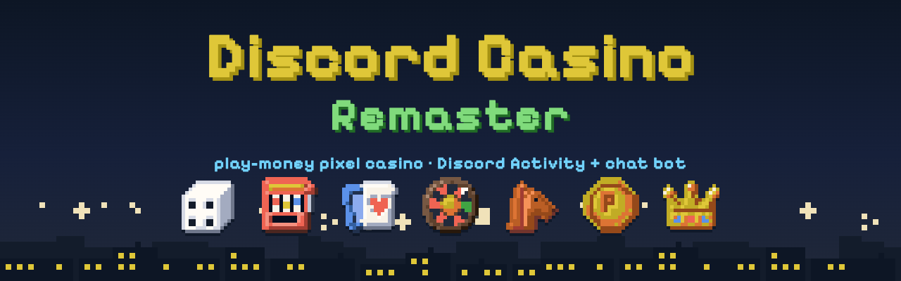
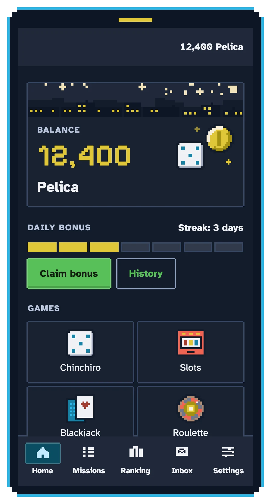
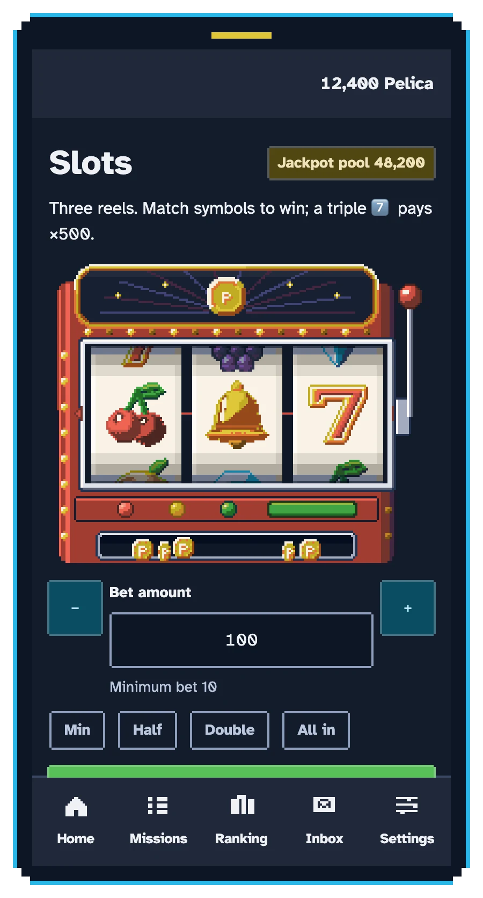
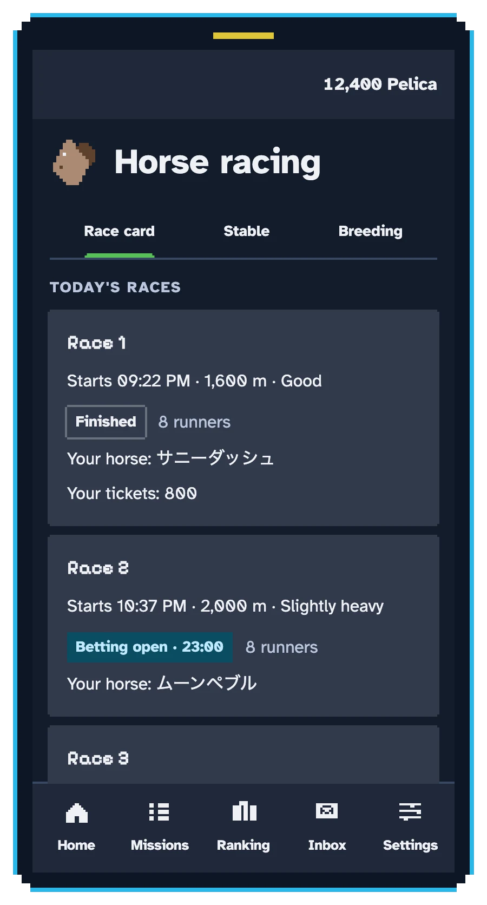
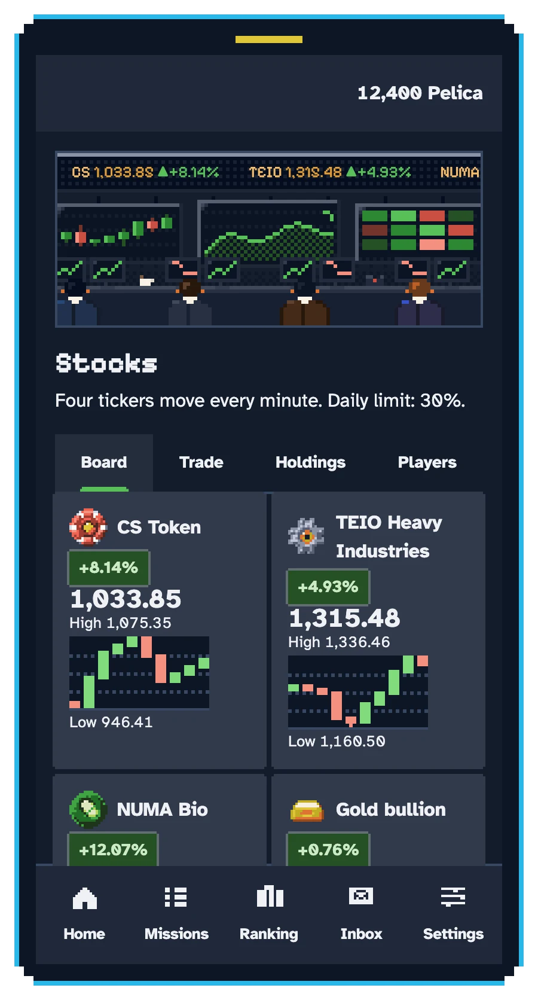
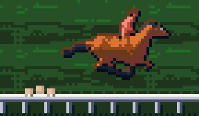
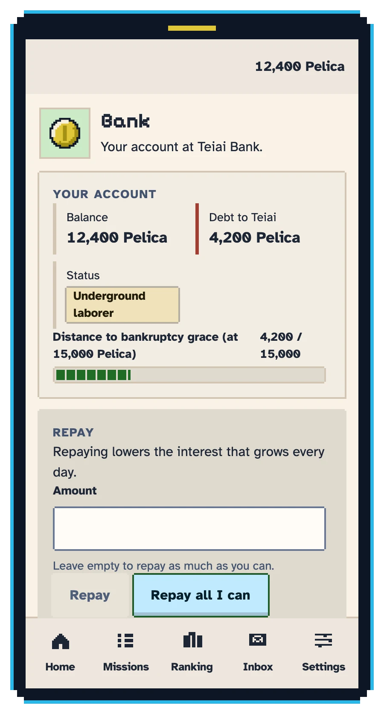
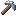

**English** | [日本語](README.ja.md)

<p align="center">
  
</p>

<p align="center">
  <b>A play-money pixel casino for your Discord server: games, horse races, stocks and a very scary bank.</b>
</p>

<p align="center">
  <a href="https://github.com/S3nc0/discord-casino-bot-remaster/actions/workflows/ci.yml"></a>
  <a href="LICENSE"></a>
  <a href="docs/OWNER_SETUP.md"></a>
  <a href="docs/OWNER_SETUP.md"></a>
  
</p>

> [!NOTE]
> **Pelica (ペリカ) is play money.** It has no cash value, cannot be cashed out and cannot be bought. Every server has its own balance, and everyone starts with 3,000 Pelica.

## A look inside

Everything below runs inside Discord as an **Activity** (a mini app on your phone or desktop), with the same pixel look in dark and light. These screenshots use made-up mock data.

<table>
  <tr>
    <td align="center"></td>
    <td align="center"></td>
    <td align="center"></td>
    <td align="center"></td>
  </tr>
  <tr>
    <td align="center"><b>Home</b></td>
    <td align="center"><b>Slots</b></td>
    <td align="center"><b>Horse racing</b></td>
    <td align="center"><b>Stocks</b></td>
  </tr>
</table>

<p align="center"><br><sub>One gallop stride, eight frames, as the race screen plays it.</sub></p>

<details>
<summary>Light mode, too: the Teiai Bank screen</summary>

<p align="center"></p>

</details>

## What you can do

<table>
  <tr>
    <td width="33%"> <b>Chinchiro</b><br>Three dice against the dealer. Roll up to 3 times.</td>
    <td width="33%"> <b>Slots and Pachinko</b><br>Pull the lever. Chase the jackpot.</td>
    <td width="33%"> <b>Blackjack and Roulette</b><br>Hit, stand, double. Or bet it all on red.</td>
  </tr>
  <tr>
    <td> <b>Horse racing</b><br>Race your own horse. Buy tickets. Breed the next champion.</td>
    <td> <b>Underground Arena</b><br>Bet on a daily tournament of NPC fighters.</td>
    <td> <b>Stocks and crypto</b><br>Four tickers that move every minute. Margin and options for the brave.</td>
  </tr>
  <tr>
    <td> <b>Teiai Bank (帝愛銀行)</b><br>Borrow, repay, and try not to go bankrupt.</td>
    <td> <b>Underground labor</b><br>Out of Pelica? Dig for ore and relics.</td>
    <td> <b>Lottery, quiz and polls</b><br>Server-wide fun that anyone can start.</td>
  </tr>
  <tr>
    <td> <b>Rankings</b><br>Weekly champion, net assets and current assets.</td>
    <td> <b>Shop and market</b><br>Titles, colors, items. Trade with other players.</td>
    <td> <b>Safe by design</b><br>Your bet is held first and settled in one step, so no coins vanish mid-game.</td>
  </tr>
</table>

Every screen opens on its own detailed pixel scene, drawn for day (light) and night (dark): a slot cabinet with chasing bulbs, a blackjack table, a grandstand and starting gate, the arena pit, the mine, the bank hall, the trading floor and more. They play short animations, and stay still when you ask for reduced motion.

The interface speaks **English and Japanese** and follows your Discord language.

## Quick start

You need Node.js 24, pnpm 12.21.0, a Discord account and a free Cloudflare account. The first run takes about 20 to 30 minutes.

1. **Get the code.** `git clone` the repo, then `pnpm i` and `pnpm -r build`.
2. **Create a Discord app** in the Developer Portal and note its Application ID, public key and bot token.
3. **Host the web app** on Cloudflare Pages.
4. **Create your `.env`** from `.env.example` and start a tunnel (`cloudflared`) so Discord can reach your server.
5. **Start everything:** `pnpm dev:server`, then `pnpm commands:deploy:guild`, then open the Activity from the rocket icon in your server.

```sh
git clone https://github.com/S3nc0/discord-casino-bot-remaster.git
cd discord-casino-bot-remaster
pnpm i && pnpm -r build
```

> [!IMPORTANT]
> Never share your bot token, client secret or `SESSION_SECRET`. `.env` is git-ignored: keep it that way.

The full, click-by-click walkthrough is the **[Owner Setup Guide](docs/OWNER_SETUP.md)** ([日本語](docs/OWNER_SETUP.ja.md)). To check your install afterwards, see the [Owner Testing Guide](docs/OWNER_TESTING.md).

## Play in chat or in the Activity

Both use the same balance and the same rules, so mix them freely. Chat commands are quick. The Activity is the full-screen experience, with live tables and race cards.

Discord shows command names in your own language, so a Japanese client sees the Japanese names.

| What you want | English | 日本語 |
| --- | --- | --- |
| Claim your daily bonus | `/pelica daily` | `/ペリカ デイリー` |
| Check your balance | `/pelica balance` | `/ペリカ 残高` |
| Roll the dice | `/casino chinchiro` | `/カジノ チンチロ` |
| Spin the reels | `/casino slots` | `/カジノ スロット` |
| Play blackjack | `/casino blackjack` | `/カジノ ブラックジャック` |
| Visit your stable | `/horse stable` | `/競馬 厩舎` |
| Bet on the arena | `/arena tournament` | `/闘技場 大会` |
| Check the market | `/market board` | `/証券 市況` |
| Visit Teiai Bank | `/pelica bank` | `/ペリカ 帝愛` |
| Dig for ore | `/labor work` | `/地下 作業` |
| Open the shop | `/shop` | `/ショップ` |
| Run a stream panel ([guide](docs/stream.md)) | `/stream start` | `/配信 開始` |
| Ask for help | `/help` | `/help` |

## Admin

Owners can approve servers, hand out or fix balances, start events, tune payout levels and manage quizzes with `/admin` (`/運営`). The **[Owner Admin Guide](docs/OWNER_ADMIN.md)** ([日本語](docs/OWNER_ADMIN.ja.md)) shows how to copy your IDs, become an admin and use every command, with a first-five-minutes walkthrough.

## Run it on a Raspberry Pi

One Node process and one SQLite file: no Redis, no database server. A 64-bit Pi runs it happily, and a one-command installer sets up the service and the tunnel. See the **[Raspberry Pi guide](docs/PI_SETUP.md)** ([日本語](docs/PI_SETUP.ja.md)).

## Tech stack

| Part | What we use |
| --- | --- |
| Language and tools | TypeScript, Node.js 24, pnpm workspaces, Vitest, ESLint, Prettier |
| Server | Fastify, Socket.io, discord.js (Guilds intent only), SQLite via better-sqlite3, croner |
| Activity | React 19, Vite, Zustand, Discord Embedded App SDK |
| Look and sound | Bitbloom pixel UI kit, Pixelify Sans, Atkinson Hyperlegible, ZzFX synth sounds |
| Hosting | Cloudflare Pages and Tunnel, or a Raspberry Pi |

## Project layout

```text
apps/server/     chat bot, HTTP and socket API, scheduler, SQLite
apps/web/        the Discord Activity (React + Vite)
packages/shared/ contracts, ids and the EN/JA text
packages/domain/ pure game rules, no I/O
packages/ui/     Bitbloom pixel components, icons and sounds
catalogs/        tunable numbers (YAML)
docs/            guides, specs and architecture notes
design/          Bitbloom design tokens
tools/pixel-art/ generators for every icon, sprite and scene
tests/           multi-client socket suites and ledger property tests
ops/             Raspberry Pi kit and tunnel templates
```

The original Python bot is not in the tree any more; it lives in git history before v1.0.0.

New here? Start with [docs/ARCHITECTURE.md](docs/ARCHITECTURE.md), then the [behaviour specs](docs/spec/INDEX.md). Project progress lives in [docs/STATUS.md](docs/STATUS.md).

**For maintainers:** [Maintainer guide](MAINTAINERS.md) · [Contributing](CONTRIBUTING.md) · [Security](SECURITY.md) · [Changelog](CHANGELOG.md) · [Architecture](docs/ARCHITECTURE.md) · [Credits](CREDITS.md)

## Credits

- **Upstream bot:** [fatcorn753/discord-casino-bot](https://github.com/fatcorn753/discord-casino-bot), the original Discord casino bot and the source of the game rules. This is a hard fork, rewritten in TypeScript as an Activity plus chat bot.
- **Authors:** fatcorn753 (original) and S3nc0 (remaster), as in the [LICENSE](LICENSE).
- **Assets:** ZzFX sound synth, Pixelify Sans, Atkinson Hyperlegible, the codixel pixel art kit and the public-domain and CC0 references behind the horse, the fighters and the miner. Authors and licenses are listed in [CREDITS.md](CREDITS.md).

## License

[MIT](LICENSE). Use it, change it, share it, and keep the copyright notice. It is provided as is, without warranty.
